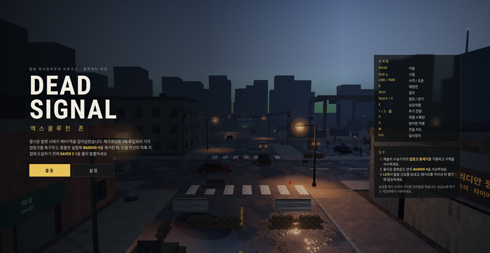
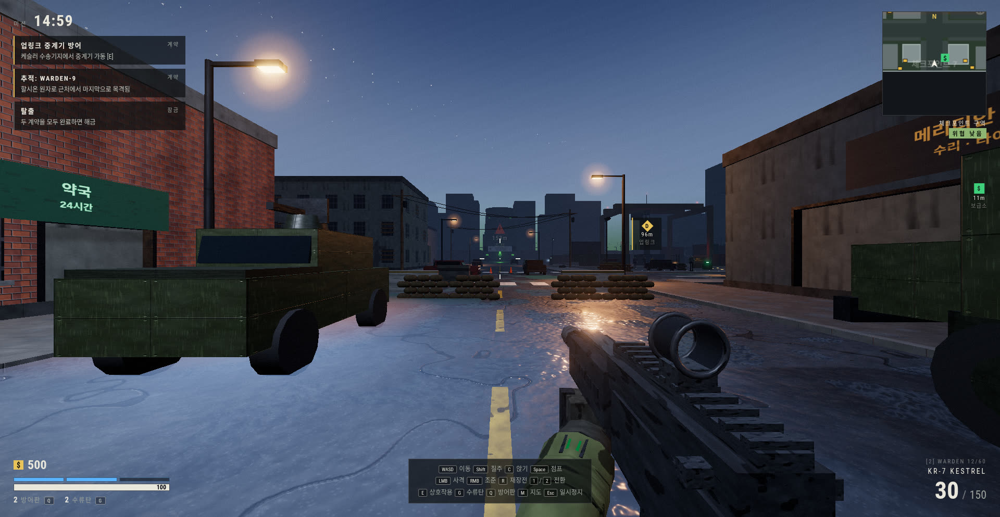

# 데드 시그널: 엑스클루전 존 (Dead Signal: Exclusion Zone) — 한국어판

> 원작: [bridge-mind/claude-opus-5.5-zombies-game](https://github.com/bridge-mind/claude-opus-5.5-zombies-game) (MIT License)
> 이 저장소는 원작을 한국어로 번역한 비공식 한글화 포크입니다. 모든 원저작권과 크레딧은 원저작자(BridgeMind)에게 있습니다.

**플레이:** https://sigco3111.github.io/claude-opus-5.5-zombies-game/

## 소개

「데드 시그널: 엑스클루전 존」은 Three.js와 TypeScript로 만들어진 싱글플레이 브라우저 FPS로, 오염된 산업 지역(제9구역)에 투입되어 두 개의 계약(임무)을 완수한 뒤 헬기로 탈출하는 익스트랙션 서바이벌 슈터입니다. 서버나 계정 없이 브라우저에서 바로 실행됩니다.

- 격리된 산업 지역을 탐험하며 보급품 캐시를 수색하고 전리품(Salvage)을 모읍니다
- 위협 등급(낮음/보통/높음)에 따라 좀비 구성, 체력, 피해량, 보상이 달라집니다
- 보급소와 무기고 개조대에서 탄약·방어판·수류탄·산탄총 구매 및 무기 강화(TIER I/II)
- 두 계약 완료 후 오염 전선이 확산을 시작하며, 5분 30초의 탈출 제한시간 안에 헬기에 탑승해야 합니다

## 스크린샷





## 임무 (약 8~10분)

1. **업링크 중계기 방어** (케슬러 수송기지 · 위협 보통): 중계기를 가동한 뒤 표시된 구역 안에서 60초 동안 전송을 지켜냅니다. 구역을 벗어나면 진행도가 서서히 감소합니다.
2. **추적: WARDEN-9** (할시온 컴파운드 · 위협 높음): 거대한 중장갑 정예 감염체. 헬멧을 먼저 벗긴 뒤 머리를 노려야 합니다.
3. **탈출**: 두 계약을 완료하면 오염 전선이 원자로에서 퍼져 나오며 제한시간이 5:30으로 고정됩니다. LZ의 무전기로 RAVEN 2-1을 호출하고, 최종 떼거리를 75초 동안 막아낸 뒤 헬기 문 앞에서 E를 눌러 탑승하세요. 사망하거나 시간이 끝나면 실패입니다.

## 조작법

| 키 | 동작 | 키 | 동작 |
| --- | --- | --- | --- |
| WASD | 이동 | E | 상호작용 |
| 마우스 | 시점 | 1 / 2, 휠 | 무기 전환 |
| LMB / RMB | 사격 / 조준 | G | 파열 수류탄 |
| R | 재장전 | Q | 방어판 적용 |
| Shift | 질주 | M (또는 Tab) | 전술 지도 |
| Space / C | 점프 / 앉기(토글) | Esc | 일시정지, 마우스 해제 |

보급소나 무기고 개조대에서는 **E**로 열고 **숫자 키(3–6)**로 구매합니다.

## 실행 환경

WebGL과 마우스 포인터 잠금을 지원하는 데스크톱 브라우저(최신 Chrome, Edge, Firefox, Safari)가 필요합니다. 모바일은 지원하지 않습니다.

## 한글화 범위

- 타이틀, 설정, 일시정지, 결과 화면 등 모든 메뉴와 버튼
- HUD: 계약 카드, 지역명·위협 등급, 무기/탄약/방어구 표시, 안내 프롬프트, 토스트 알림
- 전술 지도·미니맵 레이블 및 범례
- 3D 월드 내 표지판(격리 구역, 보급소, 무기고, 약국, 연구단지 등) 텍스처 텍스트
- 한국어 글리프를 포함하는 경량 폰트(Noto Sans KR 서브셋)를 번들에 포함해 어떤 환경에서도 한글이 깨지지 않습니다
- 무기명(KR-7 KESTREL 등), 고유명(WARDEN-9, RAVEN 2-1), 게임 타이틀 로고는 원작 그대로 유지

## 기술 스택

- **Three.js** — 3D 렌더링(프로시저럴 텍스처·모델, 인스턴싱, 후처리)
- **TypeScript + Vite** — 정적 빌드, 서버 불필요
- **WebAudio** — 프로시저럴 합성 사운드 엔진
- **Vitest** — 순수 게임 로직 단위 테스트(무기, 생존 수치/경제, 계약/탈출, 충돌/내비게이션)

## 로컬 실행

```bash
pnpm install
pnpm dev          # http://127.0.0.1:5173
pnpm build        # 타입체크 + 프로덕션 빌드(dist/)
pnpm preview      # 프로덕션 빌드 미리보기
pnpm test         # vitest 단위 테스트
```

## 라이선스

원작과 동일한 MIT 라이선스입니다. [LICENSE](LICENSE) 참조. 원작 README(영문)는 [README.en.md](README.en.md)에 보존되어 있습니다.
